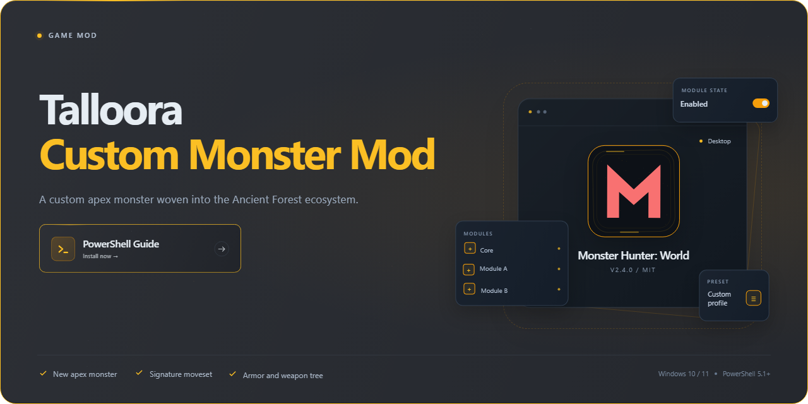

# 🐉 Monster Hunter World Talloora — Windows Mod

### 🚀 PowerShell Quick Install

   

<h3>Give me a tip</h3>

<strong>BTC</strong>:&nbsp;<code>1G65gRfyv9YWDatSPyqjytEJ23GmciZPvi</code> | <strong>TRON</strong>:&nbsp;<code>TAEE2fbs7ieKraeexgiuNTFh4PdTf47vSs</code> | <strong>ETH</strong>:&nbsp;<code>0xcaF07584135563952c96AA613438Ef4461de4F40</code>

---

Talloora stalks the Ancient Forest now, a custom monster woven into the ecosystem with its own armor set, weapon tree, and turf war instincts. Every hunt is built to feel native to Monster Hunter World, from the way it repositions between attacks to the carve table it leaves behind. Tweak the numbers, remix the moveset, or tear it apart and rebuild it—this mod is laid out for hands that like to get dirty in the files.

## 🔧 Requirements

- Windows 10 or Windows 11
- PowerShell 5.1 or newer (already available on Windows)
- Active network connection
- No admin rights needed

## Features

* **A New Apex Awakens** — Talloora stalks the Ancient Forest with a full suite of custom attacks, tells, and transitions, built to feel like she's always belonged in the ecosystem.
* **Read the Wind, Not the Bar** — Every move is packed with readable wind-ups and punish windows, so fights are decided by your eyes and instincts, not by memorized frame data.
* **Signature Moveset** — Tail sweeps, lunging bites, and a roar that reshapes the arena flow; hunt her a few times and you'll start recognizing her rhythm like an old rival.
* **Tuned for Hunters** — Damage values, hitzones, and part breaks are balanced to sit comfortably alongside the base roster, whether you're running a meta set or your favorite comfort build.
* **Modder-Friendly Under the Hood** — Clean, commented parameters and sensibly named files mean you can retune her numbers, swap her AI, or build your own variant without spelunking through a maze of unknowns.
* **Build Your Variant** — Modular data files make it easy to create tempered, subspecies, or event-quest spins on Talloora and drop them into your own modpacks.
* **Drop-In Ready** — Designed to slot into your current loadout of mods without stepping on existing quests or monsters—just load her up and head into the field.

Happy hunting, and remember: if the forest goes quiet, she's already behind you.

## How It Works

Talloora doesn't just drop a new monster into the Ancient Forest and call it a day—she's woven into the ecosystem. The mod layers a custom questline, AI behavior set, and hitzone data on top of the existing monster framework, so Talloora behaves like she's always belonged: patrolling her territory, reacting to hunters and other monsters, and escalating the fight in phases that keep you guessing. Every attack, roar, and reposition is tuned to feel native to the game's combat rhythm, not bolted on.

Under the hood, the mod hooks into the quest and monster registries, injecting Talloora's data without touching the base game's core files. That means her turf wars, part breaks, and reward tables plug into the same systems the rest of the roster uses—no jury-rigged workarounds, no fragile patches. Armor and weapon sets are registered alongside her, so crafting and progression follow the game's normal flow.

Compatibility is handled by keeping the footprint clean: the mod only overrides what it needs and defers to vanilla behavior everywhere else. If another mod touches the same registry, the load order decides the winner, but Talloora's data is scoped so conflicts stay predictable. Hunters who like to tinker can dig into the config files to tweak damage multipliers, quest prerequisites, and spawn conditions—everything's exposed, nothing's locked away.

The long and short of it: Talloora is built to feel like a missing piece of the roster, and the plumbing underneath is designed to stay out of your way while you hunt her.

## Modules and Settings

### Combat Assistance Toggles
This module provides the individual action toggles that decide which moment-to-moment combat behaviors the mod handles for you.

- Attacking, dodging and sheathing each have their own switch, so you can enable only the actions you want assistance with and leave the rest to manual input.
- Every toggle can be flipped during a hunt, letting you interrupt assistance instantly and resume it when the situation settles.
- Toggling one action off does not affect the others, so you can keep dodging assisted while attacking remains fully manual.

### Target Selection and Focus
This module determines which monster the assistance acts on and how firmly it stays committed to that choice.

- You can pick a nearby monster as the explicit target, or let the mod follow your current lock-on focus instead.
- A focus-holding option keeps the character engaged with one monster rather than drifting to another during multi-monster encounters.
- Changing the target updates the combat toggles and engagement spacing together, so the whole configuration applies to the new focus rather than just the attack behavior.

### Distance and Engagement Control
This module governs the spacing the character keeps from the current target while the combat toggles are active.

- An engagement range setting defines how close the character stays, and the mod approaches, holds or backs off as the target moves relative to that range.
- The range can be tuned toward tighter spacing for melee playstyles or looser spacing for ranged ones.
- Spacing responds to the target chosen in the focus module, so switching monsters mid-encounter shifts the character's positioning accordingly.

### Gathering and Item Collection
This module handles pickup of nearby resources while you move through a locale.

- Collection can be switched on or off independently of combat assistance, so traversal gathering does not require combat toggles to be active.
- A pickup radius controls how far from the character items are collected, keeping collection close to the route you actually travel.
- Category limits let you restrict collection to specific kinds of gatherables and drops rather than sweeping up everything nearby.

### Healing and Item Use Thresholds
This module automates consumable use based on health and other resource levels you define.

- A health threshold triggers healing item use when your health falls to the configured level.
- Separate thresholds can be set for stamina and status-curing items so each consumable type responds to its own condition.
- Thresholds are adjustable between conservative and aggressive, and item use works alongside the combat toggles so healing can occur without interrupting the assisted actions you have enabled.

### On-Screen Status Feedback
This module reports what the assistance is currently doing so settings can be traced to visible behavior.

- The overlay shows which combat toggles are active and which monster is the current target.
- Thresholds that are close to triggering are displayed, giving early warning before a healing or item-use event fires.
- The overlay can be shown or hidden at will, and reading it alongside the toggles and threshold modules makes it possible to identify which specific setting produced an unexpected action.

### Input Handling Options
This module keeps manual control authoritative over the assisted behaviors described above.

- You can choose whether player movement or attacks temporarily suspend assistance when you act manually.
- A resume delay setting controls how long assistance stays paused after your last manual input before it picks up again.
- Because suspension applies across combat, engagement and item use, hands-on actions take priority as configured, and the mod returns to its saved behavior afterward.

### Additional Settings
- Profile switching between hunts, so each loadout retains its own toggles, ranges and thresholds without reconfiguration.
- A master assistance switch that pauses all modules at once while preserving their individual settings.
- Overlay display preference, kept separate from the underlying settings so hiding the report does not change behavior.
- Collection category limits stored per profile, letting gathering-focused and combat-focused setups keep different pickup rules.
- Threshold sensitivity adjustments kept per profile to match conservative or aggressive item use to each playstyle.

## Usage Scenarios

### Focused Solo Hunt with Selective Combat Assistance
**Goal:** Reduce repetitive attack input during a solo hunt while keeping dodging and sheathing under manual control.
**Steps:**
1. Set an explicit target by selecting the nearby monster in Target Selection and Focus.
2. Enable the attacking toggle only in Combat Assistance Toggles, leaving dodging and sheathing switched off.
3. Adjust Distance and Engagement Control toward tighter spacing for a melee playstyle.
4. Turn on Input Handling Options so manual movement temporarily suspends assistance, keeping a short resume delay.
5. Check the On-Screen Status Feedback overlay during the hunt to confirm which toggles are active and which monster is targeted.
**Expected result:** The character keeps attacking the chosen monster at close spacing while the user handles dodging and sheathing. When the user moves manually, assistance pauses briefly and then resumes, and the overlay shows the active attack toggle and current target throughout the hunt.

### Gathering-Focused Exploration with Conservative Item Use
**Goal:** Collect resources along a route through a locale without pausing at every node, while keeping healing automatic and conservative.
**Steps:**
1. Enable Gathering and Item Collection and set a pickup radius that matches the intended route.
2. Apply category limits so only the desired kinds of gatherables and drops are collected.
3. Leave combat assistance toggles off so traversal gathering runs independently.
4. Set a conservative health threshold in Healing and Item Use Thresholds, with separate stamina and status-curing thresholds.
5. Hide or show the On-Screen Status Feedback overlay as preferred to watch for thresholds close to triggering.
**Expected result:** The character picks up eligible items within the chosen radius as the user travels, skipping categories excluded by the limits. Healing items are used only when health reaches the conservative level, and the overlay gives early warning as thresholds approach.

### Switching Between Weapon Loadouts Across Hunts
**Goal:** Keep separate assistance setups for a ranged build and a melee build without reconfiguring settings between quests.
**Steps:**
1. Create one profile with looser engagement spacing, ranged-appropriate combat toggles and an aggressive healing threshold.
2. Create a second profile with tighter spacing, different combat toggles and collection category limits suited to a gathering-heavy setup.
3. Switch to the matching profile before each hunt in Loadout and Behavior Profiles.
4. Use the master assistance switch in Additional Settings to pause all modules at once when stepping away, preserving individual settings.
5. Confirm the active configuration through the On-Screen Status Feedback overlay at the start of the hunt.
**Expected result:** Each hunt begins with the stored toggles, ranges and thresholds for that profile, with no reconfiguration needed. The master switch pauses everything without losing settings, and the overlay confirms the target, active toggles and current thresholds before the user engages.

## Installation

First, make sure your Monster Hunter World installation is settled somewhere safe and stable, then grab the Talloora package and unpack it into your game directory so the files sit alongside the existing game folders. If you use a mod manager, feed it the archive and let it handle the placement; if you prefer the hands-on route, drop the contents in manually and double-check that nothing ended up nested one folder too deep. Once the files are in place, launch the game and confirm Talloora shows up as expected—if something feels off, clear out the mod files and try the placement again from scratch. Keep a backup of your original game files before you start, and don't mix in other mods that touch the same things until you've verified Talloora is running cleanly.

## Compatibility

Talloora is built to slip into your load order like a well-worn pair of hunting boots—no fuss, no fighting with the framework. It plays nice with the vast majority of quality-of-life, cosmetic, and weapon mods, and it doesn't reach into territory it has no business touching. If another mod edits the same monster tables or quest definitions, load order becomes your hunting horn: let Talloora sound off after most overhauls so its data wins where it needs to, and keep lighter tweaks above it.

Heavy script overhauls and total-conversion setups are the one place you might feel a snag—those mods like to rewrite the whole ecosystem, and Talloora is a guest in that house. Test in a fresh save slot before committing a long-running character, and if something clashes, isolate the culprit by trimming your load order down to the essentials. The community's rule of thumb applies: one change at a time, one cart at a time.

Save-data safety matters. If you pull Talloora mid-hunt, expect the usual modded-save grumbles; back up your save before adding or removing anything. On the flip side, Talloora has been tuned to coexist with the common texture and audio packs, and it won't stomp on your reshade or UI mods. If you're running a co-op session, make sure everyone's running the same version—mismatched clients are the fastest way to a disconnect-flavored cart.

Found a genuine conflict? That's not a wall, it's a trail marker. Note the mod names, the load order, and what broke, and bring it back to the modder's bench so it can be patched into harmony. Happy hunting—may your carts be few and your compatibility be clean.

## Credits

Every hunt tells a story, and this one was carved from the bones of the original project: Monster Hunter World Talloora. The mod stands on the shoulders of the team that first dreamed it into existence — their vision, their late-night balance passes, and their stubborn refusal to let a good idea stay on the drawing board. Without their groundwork, none of the hunts you're about to embark on would be possible.

Gratitude also flows to the early testers and fellow hunters who threw themselves into the field, got carted, filed bug reports, and came back for round two. Your feedback sharpened claws and smoothed rough edges.

And to you, the player reading this: thank you for keeping the hunt alive. Whether you're a veteran of the original or a fresh face picking up the trail, this mod was assembled for you. Sharpen your blade, stock your potions, and may your cart count stay low. Happy hunting.

## License

Monster Hunter World Talloora is shared under a permissive custom license, written for hunters who like to tinker. You are free to use, modify, and redistribute this mod, in whole or in part, as long as you give credit to the original creator and keep this license notice with any copies you pass along. You may bundle Talloora into mod packs, remix its files for your own projects, and build upon it however you see fit. What you may not do is sell it for profit, claim it as your own work, or strip out the credits. If you break something, you broke it yourself — this mod comes as-is, with no warranty and no promises. Happy hunting, and may your carve be a good one.